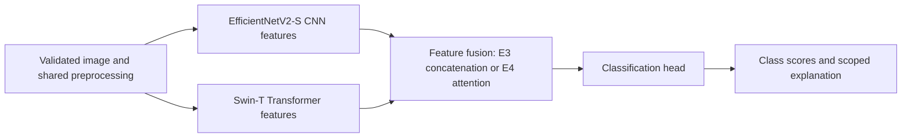

# Architecture — Phase 1 design

Status: design specification, not implemented application behavior.

## System boundaries

The ML code owns preprocessing and class mapping. The backend imports the same implementation instead of reimplementing it. Training is a separate offline process; a web request never starts model training.

## Research models

The primary reference is [Enhanced Skin Disease Classification via Dataset Refinement and Attention-Based Vision Approach](https://pmc.ncbi.nlm.nih.gov/articles/PMC11939559/). The required project extension is CNN–Transformer feature fusion. The paper's preprocessing/ViT method and our proposed fusion design must be attributed separately.

- E1: ImageNet-initialized EfficientNetV2-S with a seven-class output head.
- E2: ImageNet-initialized Swin-T with the same class order. Swin is the proposed Transformer family choice permitted by the brief. Its practical memory/latency suitability must be measured in Colab.
- E3: remove the baseline classifier heads, concatenate pooled CNN and Transformer features, and train a classification head.
- E4: project each pooled feature vector to 256 dimensions, add learned branch embeddings, apply four-head attention to the two branch tokens, pool, then classify. Attention over two feature tokens is not a pixel-level explanation.

Branch dimensions will be read from the chosen Torchvision models and checked with a real forward pass. A frozen-backbone warm-up followed by controlled fine-tuning is proposed. Fair comparisons use the same saved splits and a recorded training budget.

E1/E2 are comparison baselines; E3/E4 implement the required hybrid. Select the fusion candidate using validation evidence, report its comparison with both baselines, and disclose negative results. A standalone model cannot silently replace the required hybrid. If the hybrid cannot satisfy the export/verification gate, report the limitation and resolve it with the user before application integration.

Torchvision supplies both [EfficientNetV2-S](https://docs.pytorch.org/vision/0.24/models/generated/torchvision.models.efficientnet_v2_s.html) and [Swin-T](https://docs.pytorch.org/vision/0.24/models/generated/torchvision.models.swin_t.html). They do not supply a trained SkinDiseaseAI classifier. ImageNet initialization is not skin-lesion training.

## Shared preprocessing proposal

Decode as RGB, normalize orientation, preserve aspect ratio, pad to a square with a configured neutral color, and resize to 224 × 224. Use ImageNet channel normalization initially; save every parameter in the inference bundle. Conservative flips/rotation/color perturbation are training-only and subject to data inspection.

The proposed common 224-pixel input is an experimental resource choice. It differs from the documented EfficientNetV2-S pretrained inference recipe (384 pixels), so that recipe's ImageNet performance cannot be assumed. Validate whether padding, resolution, and augmentation preserve visible lesion information before training. Evaluation and API transforms must be deterministic and identical.

## Inference bundle

Export only after evaluation: architecture identifier and config, weights, model version, ordered class mapping, preprocessing config, dataset/split/config hashes, package versions, evaluation report references, explanation support, and calibration metadata. Validate all required files at backend startup and load only trusted artifacts produced by this project. Inference mode handles prediction; explanation requests use a separate gradient-enabled path with cleanup.

Checkpoint absence or mismatch means unavailable inference. `/health` can remain live while `/model-info` reports not ready and `/predict` returns 503. Load once per server process, not once per upload. CPU is the local inference target until latency is measured.

## Explanations

For a CNN-containing selected model, compute Grad-CAM from a suitable final convolutional feature map using gradients of the actual final class logit. For fusion, this shows the CNN spatial contribution conditional on the other branch; it does not spatially explain the entire Transformer branch. Explain a supported Transformer model only after implementing and validating a compatible method. Record target class/layer and return availability honestly.

## Web client and privacy proposal

FastAPI serves Jinja2 templates, static CSS, and plain browser JavaScript. The interface uses white/light blue and accessible focus/error states. Proposed version 1 has consent information, upload/preview, real request states, ranked scores, limitations, and an explanation when available. The browser must not imply calibrated certainty or successful skin detection from technical image validation.

Process uploaded bytes in memory; do not retain images or patient metadata by default. Do not log request bodies. Keep project development history independently of user screening results. Accounts and saved user-result history are excluded from the initial proposed scope and require a later explicit requirement. Public exposure requires a deployment review, request limits, transport security, and an access/retention decision.

## Reproducibility and recovery

Development state lives in `.project/` and Git. Model-training state is separate: persist model, optimizer, scheduler, mixed-precision scaler when used, epoch/global step, best metric, configuration, split hash, and random-generator states to durable storage. A Colab local filesystem is not the only checkpoint location. Resume is explicit and must reject incompatible configurations. Exact mid-batch replay is not promised; the documented recovery point is the last successfully saved training checkpoint.
